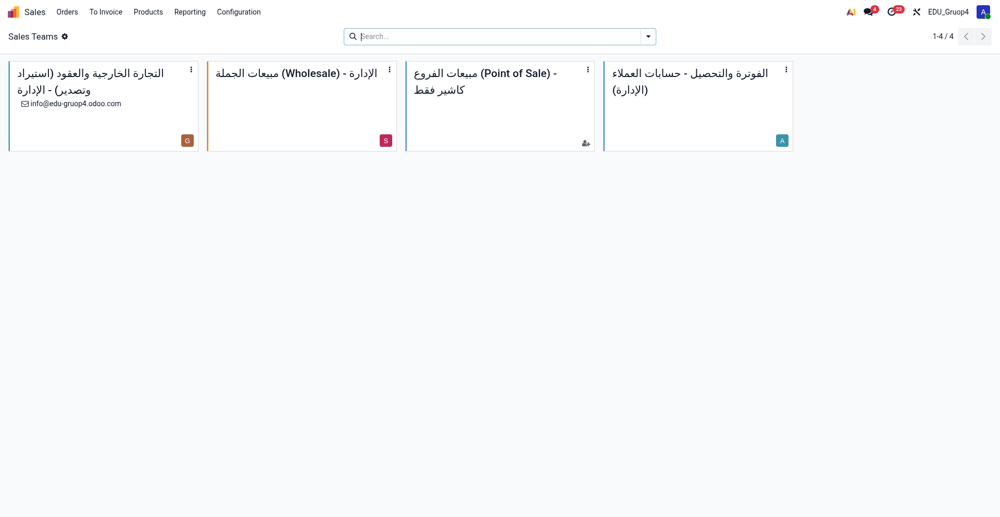
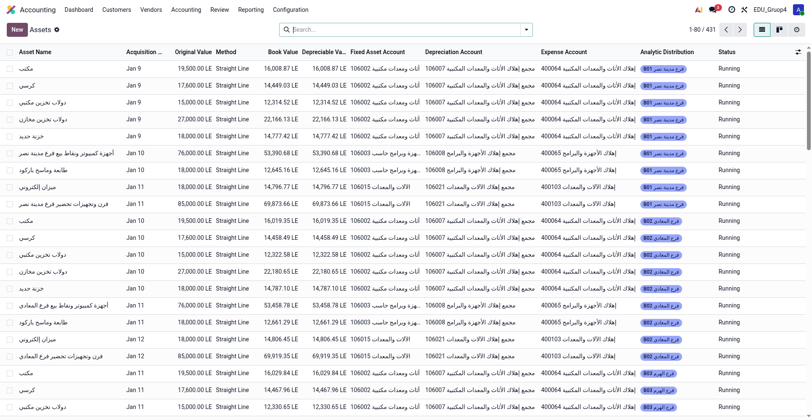
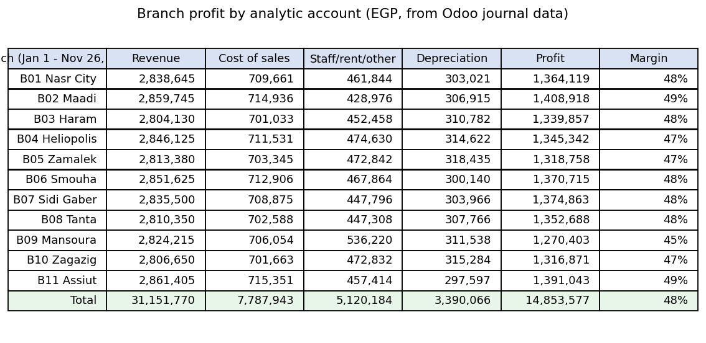

# Sweets & Halawa Manufacturer: Odoo 19 Demo Company

A fully linked demo company built in Odoo 19 (online) for study and discussion. Everything is fictional. No real company data, no credentials.

**Arabic note / ملحوظة:** دي شركة تجريبية بالكامل لصناعة الحلويات والحلاوة والطحينة، متعملة على أودو 19 عشان الدراسة والمناقشة. كل الأسماء والأرقام وهمية.

## The business

A maker of Eastern sweets, Western and Italian sweets, and halawa/tahini, with domestic retail and exports.

| Part | Count |
|---|---|
| Factories | 3 |
| Central warehouses | 4 |
| Retail branches (each with its own POS) | 11 |
| Head office | 1 |
| Period simulated | Jan 1 to Nov 26, 2026 |

Branches: Nasr City, Maadi, Haram, Heliopolis, Zamalek, Smouha, Sidi Gaber, Tanta, Mansoura, Zagazig, Assiut.

Only free Odoo apps are used: Accounting, Inventory, Manufacturing, Purchase, Sales, Point of Sale, CRM, Employees, Payroll, Attendances, Fleet, Quality, Barcode, Documents, Contacts, Calendar, Knowledge.

## Structure

- **Company:** one operating company. A previous "management" company was merged into it and left as an empty shell.
- **Analytic accounts:** one per branch (B01 to B11), head office, warehouses (C01 to C04) and factories (F01 to F03). Used for branch profit.
- **Warehouses:** each branch has a warehouse with a display-shelves location; 4 central warehouses; 3 factory warehouses.
- **Product categories:** Raw materials (dairy and eggs, sesame and sugar, chocolate and cocoa, fruit and flavours, bakery and dough, nuts), Packaging, Semi-finished (fillings and creams, syrups and mixes, doughs), Finished goods (halawa and tahini, Italian sweets, Eastern sweets, Western sweets).
- **Manufacturing:** bills of materials for finished and semi-finished items, work centers per factory, landed costs on imported raw materials.
- **Quality of data:** food damage goes through Inventory Scrap (booked to a stock-loss account). Repairs were used only for equipment and vehicles and the Repairs app was later removed.

### Sales teams

1. Foreign trade and contracts (import and export)
2. Wholesale
3. Branches (POS only)
4. Invoicing and collection

الفرق الأربعة: التجارة الخارجية والعقود، الجملة، الفروع (نقاط البيع فقط)، الفواتير والتحصيل.

## Point of Sale

- 11 POS configs, one per branch, each with a cash payment method tied to a branch safe and a shared card method.
- **Customers:** one cash customer per branch ("عميل نقدي - فرع Bxx").
- **Extras (toppings) on core items:** honey regular 20 g (10 EGP), honey extra 40 g (18 EGP), nuts 30 g (15 EGP), cream 40 g (12 EGP). Each extra is a kit product with a bill of materials, so selling it deducts raw honey, almonds or cream from the branch stock. In Odoo they are separate items the cashier taps after the main item.
- **Hot items:** every branch has an electric convection reheating oven and a hot display cabinet (no microwave).
- **Volume simulated:** January at 100 orders per day per branch (opening month), then about 35 per day (28 to 42). About 145,000 orders and 3,630 closed POS sessions. Average order about 216 EGP including 14% VAT. Payment mix 45% card, 55% cash. Cash differences per session are within 100 EGP.

## Fixed assets and depreciation

- Every asset comes from a **vendor bill** with an asset account, which creates the asset automatically. Eight vendors by type (machines, cooling and AC, furniture, IT, vehicles, decor contractors, construction, land).
- **453 assets**, depreciated **monthly**, dated from Jan 1, 2026. Depreciation posted Jan to Nov. About 1.37 million EGP per month from February.
- Classes and lives: buildings 30 years, decor 10, shelves and displays 8, AC 7, refrigeration 5, machines, furniture, IT and vehicles per their models. Land is not depreciated.
- Per branch: decor, shelves, display fridges and freezers, AC, computers, desks, chairs, cabinets, safe, scales, oven, reheating oven, hot display cabinet. Factories: production equipment per work center. Fleet: 15 vehicles including 6 refrigerated trucks, linked to Fleet records.
- A capital increase of 60 million EGP on Jan 2 funds the asset purchases, so the bank balance stays positive every month.

## Results (Jan 1 to Nov 26, 2026)

| Item | EGP |
|---|---|
| Income (all channels) | about 50.5 million |
| Expenses | about 34.8 million (of which depreciation 14.8 million) |
| Profit | about 15.7 million |
| Bank balance | about 36.8 million |

### Branch profit

Each branch earns about 2.8 million revenue (before tax) and about 1.3 to 1.4 million profit (45 to 49% margin).

## Assumptions and caveats

- **Cost of sales at branches is 25% of sales.** Stock is valued periodically, so POS sales do not book cost of goods by themselves. I added one monthly entry per branch (25% of its sales, tagged to the branch analytic account) and took the same amount out of head-office raw purchases so costs are not counted twice. The 25% is a choice, not a measurement.
- **Closing inventory** is booked on Nov 30 (about 16 million: raw 5.9, packaging 1.7, work in progress 0.4, finished goods 8.2). Opening inventory is zero because the company starts on Jan 1 with only capital.
- Stock was topped up and cut by inventory adjustments, not by transfers from factories, so there is no transfer trail for the stock the branches sold.
- Card payments from POS sit as pending bank receipts. No bank settlement entry was booked.
- POS session journal entries are dated by day, but their sequence numbers are not in date order.
- Payroll and attendance are kept for the 250 payslips and attendance records. Rental, Planning, Surveys, Repairs and Approvals were removed.
- Branch profit figures in the table were computed from the Odoo journal data by analytic account, and the image is a table of those figures, not an Odoo screen.

## Not included

No credentials, no database dump, no real-company data.
